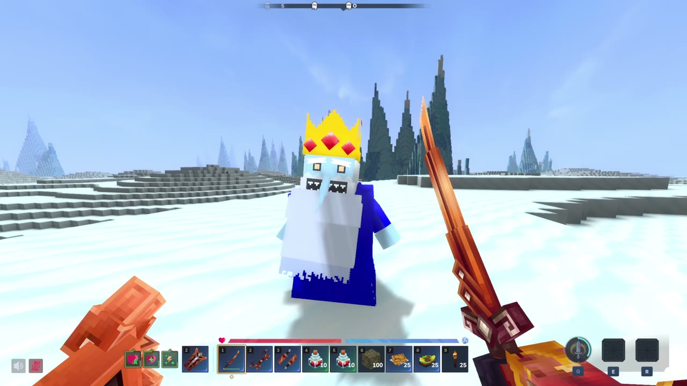
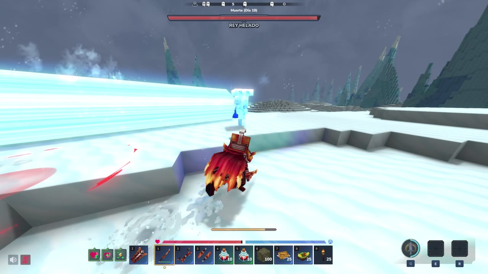
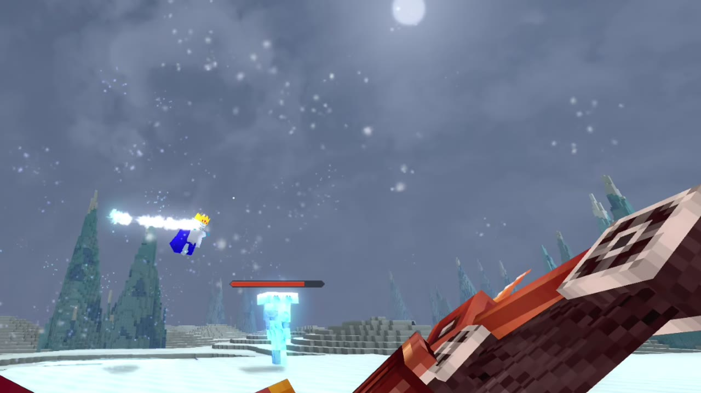
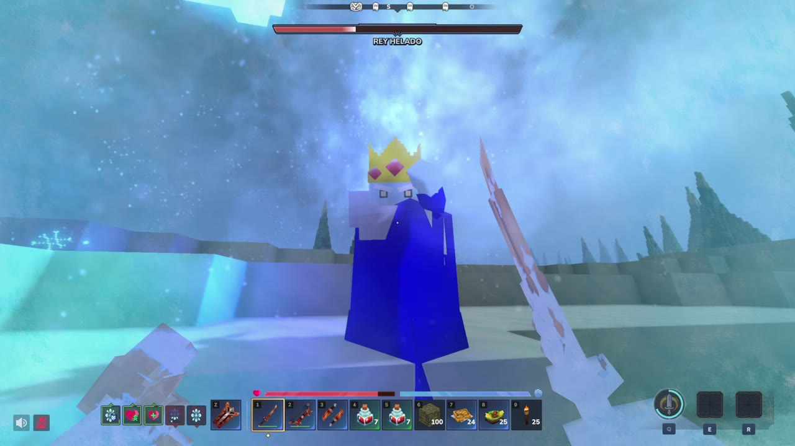
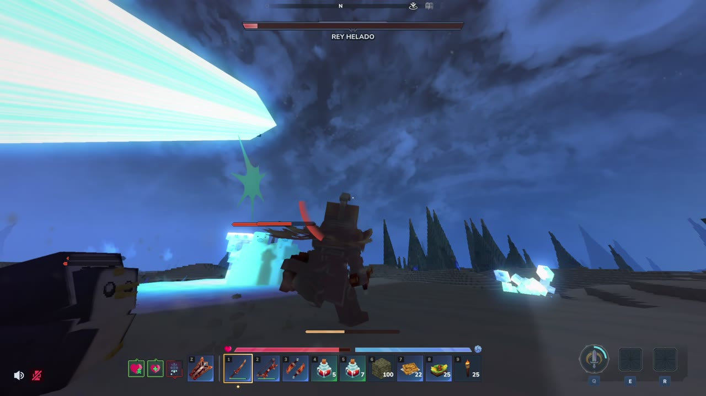
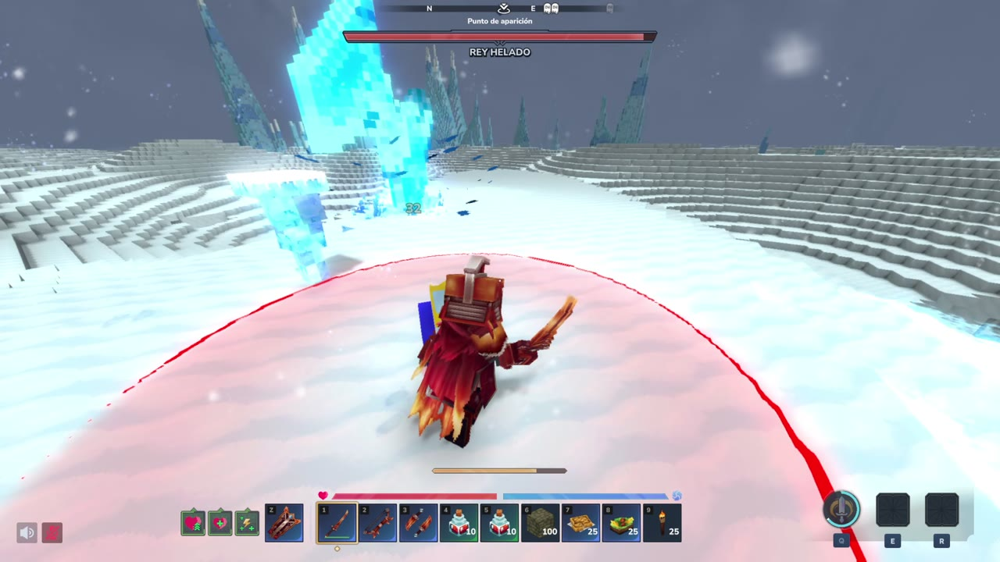
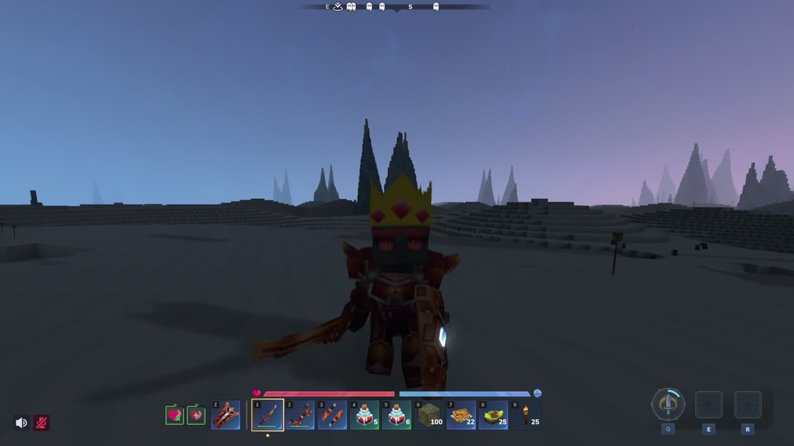

# The Ice King: a four-phase boss for Hytale

A four-phase boss for my *Adventure Time* mod: two ground phases, two flying phases, minions, a frost system and a counter-potion, plus six player runes made from his moveset. All of it is data on Hytale's NPC and Interaction frameworks, with no plugin code. Boss and biome are 100 % JSON.

- **Full fight (7:29):** https://youtu.be/f0qJtVtFRJo
- **Raw files:** this branch, or the zip attached to the [`ice-king-showcase` release](https://github.com/dackoro/Adventure-Time/releases/tag/ice-king-showcase)
- **Server version:** 0.7.4 (built on 0.7.2 / 0.7.3)
- **Author:** Dackoro ([x.com/dackoro](https://x.com/dackoro)) · MIT license

## Try it

1. Install the mod: build the jar with `.\gradlew build`, or load the release zip's folder as an asset pack.
2. In Adventure mode, stand somewhere open and run `/npc spawn AT_Ice_King`, then `/encounter add AT_Ice_King_Encounter` next to him.
3. Hit him to start the fight: the boss bar, music and a dark storm come up.

For testing:
- `/give <you> AT_Ice_King_Crown`: the crown the runes need.
- `/give <you> AT_Ice_King_Rune_<Name>`, where Name is Ice_Ray, Ice_Nova, Ice_Mace, Ice_Sword, Frost_Burst or Ice_Shield. Put the rune in a `Bench_Abilities`.
- `/give <you> AT_Ice_King_Warmth_Potion`: fire resistance plus protection from his cold.

## The fight

One health bar, four roles. The encounter watches his health and swaps his role at each threshold, but only once he has finished the attack he's in. The boss bar, music and storm stay up across every swap.

| Phase | Health | Role | What changes |
|---|---|---|---|
| 1 · Ground | 100-70 % | `AT_Ice_King_Fight` | Combat Action Evaluator `CAE_AT_Ice_King`: scepter melee, single, double and freezing rays, ice nova, iceberg cast, ice rain, the ice shield bubble, Gunter summons and the "Ice... KING!" ultimate beam. |
| 2 · Air | 70-45 % | `AT_Ice_King_Air` | Takes off and fights from 12-20 blocks up: frost beams, zaps, double rays and summons, on timers. The encounter drops icebergs and lightning on every player. |
| 3 · Fridjitzu | 45-20 % | `AT_Ice_King_Fridjitzu` | Back on the ground with nunchucks. `CAE_AT_Ice_King_Fridjitzu`: the three-hit Fridjitzu combo, the ice sword combo, the ice mace slam (a ring that grows to 15 blocks, jump it) and snowmen that grab you in a hug and melt. |
| 4 · Enraged | < 20 % | `AT_Ice_King_Air_Enraged` | Flies again, faster and lower, with everything at once: more sky drops, enraged minions, and the rage ultimate that charges, warns, then sweeps after you. |

| | |
|---|---|
|  "Ice... KING!", phase 1 |  In the air, phase 2 |
|  Fridjitzu, phase 3 |  The rage ultimate, phase 4 |

## Rules the player learns

**Frost.** Every ice hit adds a frost stack (`AT_Ice_King_Frost_1` to `_4`), and each stack slows you more. The fourth stack freezes you (`AT_Ice_King_Freeze`). Then `AT_Ice_King_Freeze_Guard` keeps you from being frozen again for 5 s, so you can't be chain-frozen.

**Block or dodge.**
- **Block** what comes straight at you, with a stamina cost: punches, the Fridjitzu combo, the ice sword, rays, zaps, the frost beam. Only the heavy finishers still add frost when blocked.
- **Dodge** what marks the ground first: the ultimate, the nova, the mace ring, the ice rain, icebergs, lightning.

**Minions.**
- Gunters slide on their bellies and knock you down like bowling pins.
- Snowmen hug you and melt.
- They're grouped in `AT_Ice_King_Minions`, so the summon caps only count the King's own and ignore wild penguins.

## How it's built

- **The encounter runs the fight** (`Server/EncounterManager/AdventureTime/AT_Ice_King_Encounter.json`). `ChangeTargetRole` at each health threshold, the boss bar, music and weather, and the sky drops. Each drop uses `ForEach` / `MultiTarget`, so every player gets their own.
- **Ground phases use a Combat Action Evaluator** (`Server/NPC/Balancing/AdventureTime/CAE_AT_Ice_King*.json`): distance curves, cooldowns and action sets per phase, in the style of the Gobliterator.
- **Flying phases have no CAE.** The vanilla flying template only has one fixed ranged attack. The rest are timer rules in a `CombatAdditionalBehaviorComponent` (`Component_AT_Ice_King_Air*_Combat.json`): `And(Target, Timer)`, then `HeadMotion Aim`, then `Attack`. Vanilla uses the same pattern for its enraged lobber.
- **More than one player:**
  - In the air he retargets to whoever hurt him most (`Damage` sensor with `TargetSlot`, at most every 4-6 s). Otherwise he swaps to the next nearest player every 8-12 s.
  - His health grows by 1000 for each extra player within 80 blocks (`AT_Ice_King_Scale_Health_P*`). This happens before the fight starts and holds across role changes, as with the Gobliterator.
- **Templates.** `Template_AT_Ice_King.json` and `Template_AT_Ice_King_Flying.json` start from the vanilla intelligent and flying templates, and their own comments are kept. Each file's top comment lists what changed.
- **Runes.** Each rune is its own `AT_Ice_King_Rune_*` interaction chain that calls the King's shared frost interactions, so the frost rules are identical for players and boss. Runes only cast while wearing his crown (the `AT_Ice_Magic` stat).

| Content | Count |
|---|---|
| NPC roles | 16 |
| Root interactions | 49 |
| Interactions | 83 |
| Projectile configs | 26 |
| Entity effects | 37 |
| Particle files | 84 |
| Sound events | 41 |
| Animations | 198 |

## Tuned with fight reports

The King logged each attack, and a small debug plugin logged every hit, effect, heal and position. A script turned that into a report per fight: accuracy per attack, damage per phase, time frozen and slowed, blocks and stamina, attacks that never came up, and how often each voice line repeats. It also ran unattended fights back to back. That's how I found the bug where the King froze in place: a projectile removed on impact left a forked interaction chain that never finished. The fix is a 0.4 s wait before each falling projectile removes itself.

My own clear (sword, shield and bow, no potion, 7:42, no deaths):

| Phase | Time | Attacks | Damage taken | Per minute | Frozen | Slowed |
|---|---:|---:|---:|---:|---:|---:|
| 1 · Ground | 2:13 | 43 | 998 | 450 | 3× | 46 % |
| 2 · Air | 2:41 | 64 | 1452 | 541 | 8× | 53 % |
| 3 · Fridjitzu | 1:23 | 41 | 554 | 400 | 5× | 79 % |
| 4 · Enraged | 1:25 | 41 | 1794 | 1266 | 6× | 53 % |

Phase 4 hits about three times harder per minute than the others, mostly from the sky drops, so that's what I'm tuning next.

## Six runes from his moveset

His crown unlocks six ability runes. Each one reuses his attack animations.

| Rune | What it does | Cooldown |
|---|---|---:|
| Ice Ray | His ice ray | 3 s |
| Ice Nova | Burst around you that pushes enemies away | 12 s |
| Ice Mace | Three slams, each sending out a ring | 15 s |
| Ice Sword | Step in, two slashes and a finisher | 10 s |
| Frost Burst | Five quick bolts; land all five and the target freezes | 8 s |
| Ice Shield | His bubble, then it bursts | 25 s |

## Where things are

| What | Path |
|---|---|
| Roles (boss phases, minions, pillar) | `Server/NPC/Roles/AdventureTime/Ice_King/` |
| Combat Action Evaluators | `Server/NPC/Balancing/AdventureTime/CAE_AT_Ice_King*.json` |
| Encounter | `Server/EncounterManager/AdventureTime/AT_Ice_King_Encounter.json` |
| NPC groups | `Server/NPC/Groups/AdventureTime/AT_Ice_King_*.json` |
| Root interactions | `Server/Item/RootInteractions/NPCs/AdventureTime/Ice_King/` |
| Interactions | `Server/Item/Interactions/NPCs/AdventureTime/Ice_King/` |
| Projectiles | `Server/ProjectileConfigs/NPCs/AdventureTime/` |
| Effects | `Server/Entity/Effects/AdventureTime/Ice_King/` |
| Particles | `Server/Particles/AdventureTime/Ice_King/` |
| Sound events | `Server/Audio/SoundEvents/AdventureTime/Ice_King/` (audio in `Common/Sounds/AdventureTime/Ice_King/`) |
| Items (crown, nunchucks, runes, potion) | `Server/Item/Items/AdventureTime/Ice_King/` |
| Models and animations | `Common/NPC/AdventureTime/Ice_King/`, `Common/Characters/Animations/Items/AdventureTime/Ice_King/` |
| Drops | `Server/Drops/NPCs/AdventureTime/Drop_AT_Ice_King.json` |

## Also here: the Ice Kingdom

His home is a World Gen V2 biome inside an instance:
- `Server/HytaleGenerator/Biomes/IcelandBiome.json`
- `Server/HytaleGenerator/WorldStructures/IceLandStructureAsset.json`
- `Server/Instances/IcelandInstance/`

It has its own fauna, Gunter the penguin and a snow leopard. Enter it with `/instances spawn IcelandInstance`. The castle site is a placeholder for now. The rest of the repo is the rest of the Adventure Time mod (the swords). Its only Java is a small plugin for one sword's curse, unrelated to the boss.
